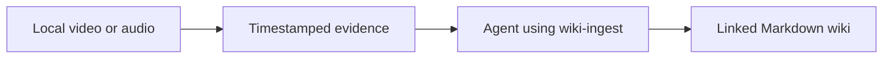

<h1 align="center">obsidian-wiki-video</h1>

<p align="center"><b>Turn video, audio, and documents into a linked wiki with your AI agent.</b></p>

<p align="center">
  Keep the knowledge, the context, and the original audio evidence.<br>
  Markdown first. Skill driven. Built on obsidian-wiki.
</p>

<p align="center">
  <a href="https://github.com/Amiannn/obsidian-wiki-video/pulls"></a>
  <a href="LICENSE"></a>
</p>

<p align="center">
  
</p>

<p align="center">
  
</p>

<p align="center">
  English | <a href="./README_TW.md">繁體中文</a>
</p>

---

A video/audio extension of [Ar9av/obsidian-wiki](https://github.com/Ar9av/obsidian-wiki), following the same idea: **agents compile sources into linked Markdown knowledge, then keep it current.** This fork adds timestamped transcripts, sampled frames, playable audio excerpts, and audio measurements as evidence for the existing `wiki-ingest` skill.

The wiki can connect what was said with how it was expressed. Speaking-style observations stay tied to source segments, with measurements separated from agent interpretation. Concepts, reference pages, cross-links, source tracking, and incremental updates keep the upstream workflow.

Skills remain Markdown instructions for Claude Code, Cursor, Codex, Windsurf, Gemini CLI, and [other compatible agents](./docs/agents.md). The core CLI stays lightweight; local media extraction adds optional Python dependencies and FFmpeg. Knowledge synthesis uses your configured agent.

The underlying pattern comes from Andrej Karpathy's [LLM Wiki gist](https://gist.github.com/karpathy/442a6bf555914893e9891c11519de94f): compile knowledge once, connect it, and maintain it as new evidence arrives.

## Quick start

**Install this fork to get the media commands.** Installing `obsidian-wiki` from PyPI or the upstream skills-only plugin does not install this branch's media implementation.

Requires Python 3.9+ and system `ffmpeg` / `ffprobe`. The example below uses a Bash-compatible shell; on Windows, use your virtual environment's activation command.

```bash
git clone --branch feat/video-ingest https://github.com/Amiannn/obsidian-wiki-video.git
cd obsidian-wiki-video
python -m venv .venv
source .venv/bin/activate
python -m pip install -e '.[media]'
obsidian-wiki setup --vault ~/video-wiki
```

The CLI/package name remains `obsidian-wiki`. Setup installs skills and registers session hooks; add `--no-hooks` to skip the hooks. Then tell your agent **"set up my wiki"** to initialize the wiki content.

For text-only use, install with `python -m pip install -e .` instead. See [Installation](./docs/installation.md) for the inherited setup options; use the fork installation above for video/audio.

## From a video to a wiki

Prepare a local recording in the same activated environment:

```bash
obsidian-wiki media prepare /path/to/video.mp4 \
  --vault ~/video-wiki --language zh --pitch
```

Use `--language en` for English, or omit it for automatic detection. The default is faster-whisper `small`, running locally on CPU with `int8`; the first use downloads model weights. GPU options and externally supplied transcripts are described in [Video and audio ingestion](./docs/media.md).

The command returns JSON containing a `source` path. Give that exact path to your agent:

```text
/wiki-ingest <source path returned by media prepare>
```

`media prepare` extracts evidence; **the agent performs the wiki compilation**. A prepared or cached bundle does not mean its knowledge has been ingested yet.



| Evidence | What this version provides |
|---|---|
| Speech content | ASR transcript with approximate segment timestamps, or supplied transcript JSON |
| Visual context | Uniformly sampled frames for a vision-capable agent to inspect |
| Audio playback | Original media, extracted audio, and representative playable excerpts |
| Delivery measurements | RMS level, low-energy intervals, transcript characters per minute, optional pitch percentiles |
| Traceability | Source hashes, processing settings, segment citations, and reusable extraction bundles |
| Wiki integration | Existing categories, page merging, cross-links, snapshots, manifest, and memory updates |

Audio measurements support interpretation: low energy is not necessarily a speaking pause, and character rate is not words per minute. Emotion, personality, and stable speaking style are not automatically classified. Style observations require cited examples and context.

**Current scope:** local files only; no YouTube downloader, automatic speaker diarization, scene detection, or automatic OCR. Supplied speaker labels stay local to a recording. The initial trial used 11 seconds of English speech with a clearly labeled synthetic slide; Mandarin ASR quality and complex video understanding have not been benchmarked. The local trial vault is not included in the repository.

Formats, output structure, cache behavior, and validation details → **[Video and audio ingestion](./docs/media.md)**

## What you actually do

**Feed it.** Documents, PDFs, chat exports, meeting transcripts, screenshots, URLs, and local video/audio through the evidence preparation step above.

```text
/wiki-ingest ~/research
/wiki-update                        # distill the repo you're standing in (code-graph aware)
/wiki-capture                       # save this conversation
/wiki-history-ingest claude         # mine everything you've ever asked Claude
```

**Ask it.** Answers come back with `[[wikilink]]` citations, not vibes.

```text
/wiki-query what do I know about rate limiting?
/wiki-narrate MCP security          # a cited briefing on a topic
/wiki-digest week                   # what did I learn this week?
```

**Find that session you can't name.**

```bash
obsidian-wiki sessions-build
obsidian-wiki sessions-query "the auth bug with the weird retry loop"
```

**Keep it honest.** The vault gets messy on its own; these clean it.

```text
/wiki-lint            # broken links, orphans, contradictions
/wiki-dedup           # "RSC" and "React Server Components" are one page now
/cross-linker         # weave new pages into the graph
/wiki-status          # what's ingested, what's pending, where the hubs are
```

All skills → **[Skills Reference](./docs/skills.md)**

## See it

Open the vault in Obsidian and hit the graph view (Cmd/Ctrl+P → "Open graph view"). Say **"color my graph"** and it tints nodes by tag, category, or visibility.

Want to look before you build? [`examples/demo-vault/`](./examples/demo-vault) is an 18-page sample vault on building reliable LLM agents, already colored by folder. Clone the repo, choose *Open folder as vault* in Obsidian, and pick that folder.

<p align="center">
  
</p>

Or export the whole graph to `graph.json`, GraphML (Gephi/yEd), Neo4j Cypher, Postgres SQL, or a self-contained interactive `graph.html`.

## Use it from Python

```python
from obsidian_wiki import Memory

memory = Memory("~/brain")
memory.remember("stack", "Python, FastAPI", confidence=0.9)
memory.add("Postgres was chosen over MySQL for partial indexes.")
memory.search("postgres")
memory.recap()                       # inject at session start
```

No API key, no embedding model, no vector store, no network — the vault is markdown on disk, so everything your agent remembers is readable, greppable and diffable. `user_id` scopes per-person memory while knowledge stays shared.

More → **[Python API](./docs/python-api.md)**

## It remembers between sessions

A session starts with the vault's memory already in context — who you are, what threads are open, what changed recently — and ends by capturing anything reusable before the context closes.

<p align="center">
  
</p>

`index.md`, `log.md`, `hot.md`, and the owner profile and todo index under `_meta/` all go through one writer that takes a lock and writes atomically, so parallel agents can't drop each other's updates.

More → **[Memory Surface](./docs/memory.md)**

## Why this and not a notes folder

- **It compiles, it doesn't accumulate.** New knowledge merges into existing pages. Contradictions get flagged. Nothing gets duplicated.
- **It only reads what changed.** A manifest tracks every source ingested, so the second run processes the delta — not your whole library again.
- **You can tell knowledge from guessing.** Every claim is tagged `extracted`, `^[inferred]`, or `^[ambiguous]`, and lint flags pages drifting into speculation.
- **Queries stay cheap as it grows.** Titles, tags, and summaries get read before page bodies. 20 pages or 2000, roughly the same cost.
- **It's yours.** Plain markdown in a folder. Push it to a private repo, open it in Obsidian, grep it, delete it. Local storage with no required hosted wiki service. Your agent provider determines how synthesis inputs are processed.
- **It carries context across sessions.** An owner profile, open threads, and a running snapshot get injected at session start, so you don't re-explain yourself.
- **Works where you already work.** One `.skills/` directory, symlinked into every agent you use.

More → **[Architecture](./docs/architecture.md)**

## How it compares

| | obsidian-wiki-video | Desktop LLM-wiki apps | MCP memory servers | Single-skill LLM wikis |
|---|---|---|---|---|
| **Where knowledge lives** | Markdown in your Obsidian vault | A folder the app manages | A database or event log | A markdown folder |
| **Works with** | Claude Code, Codex, Cursor, Gemini CLI, and a dozen more | The app itself | Any MCP client | Usually one agent |
| **What you install** | Markdown skills; media ingestion adds the Python CLI, optional packages, and FFmpeg | A desktop app plus an LLM API key | A server process | One skill |
| **Mines past agent sessions** | Claude, Codex, Copilot, Hermes, OpenClaw, Pi | No | Captures new sessions only | No |
| **Keeps itself clean** | Lint, dedup, cross-linking, tag taxonomy | Varies | Not applicable | Lint, if anything |

## Does it actually help?

The following graph-query results come from the upstream project. They are not a video/audio benchmark of this fork; see [prototype validation](./docs/media.md#prototype-validation) for the media trial.

Structural questions — "how is X connected to Y", "which pages hold my vault together",
"what breaks if I delete this" — are the ones a plain agent is worst at. It has to grep
every file and reconstruct the link graph by hand, every single time.

Same model, same vault, same questions. The only difference is whether `obsidian-wiki`
was installed:

| | Plain agent | With obsidian-wiki |
|---|---|---|
| **Time to answer** | 81s | **19s** — 4.4× faster |
| **Correct answers** | 44% | **83%** |
| **Tool calls used** | 9.9 | **4.6** |
| **API cost** | $0.202 | $0.208 — unchanged |

| Question | Plain agent | With obsidian-wiki |
|---|---|---|
| "How is X connected to Y?" | 122s | 18s |
| "What topic clusters do I have?" | 117s | 21s |
| "Which pages hold my vault together?" | 61s | 12s |
| "What breaks if I delete X?" | 26s | 24s |

The accuracy gap is not a rounding error. Asked to trace a connection, the plain agent
routed through `index.md` — which links to *every* page, so it "found" a short path that
means nothing. It made the same mistake in both runs, and named `index` as one of the
most important pages in the vault. The graph the skills query excludes bookkeeping files,
so that answer isn't reachable.

<details>
<summary>Method, and what this doesn't prove</summary>

Claude Sonnet, headless, on a real 38-page vault. Questions were asked in plain English
with no definition of the graph supplied — the plain agent had `Read`/`Grep`/`Glob`/`Bash`
and had to work it out, which it did competently (it wrote its own centrality
implementation rather than guessing). 4 questions × 2 conditions × 2 repetitions, run
serially so nothing competed for CPU.

Ground truth came from **networkx**, not from this project's own code: betweenness matches
to 3.5e-18 across every node, and all 630 shortest-path pairs agree.

It's a small study — n=2 per cell on one 38-page vault — so treat the exact percentages as
indicative. The wall-clock gaps (3–6×) are much larger than the run-to-run spread; the
accuracy figures rest on fewer samples. One run in the "with" column failed outright: the
model ignored the CLI, grepped by hand, and got it wrong.

Full data, per-run logs and the scaling measurements are in
[PR #175](https://github.com/Ar9av/obsidian-wiki/pull/175).

</details>

## Documentation

| | |
|---|---|
| **[Video and audio ingestion](./docs/media.md)** | Media setup, measurements, evidence bundles, limitations, and validation |
| **[Installation](./docs/installation.md)** | pip, clone, agent-driven setup, multiple vaults |
| **[Skills Reference](./docs/skills.md)** | All skills and their slash commands |
| **[Agent Compatibility](./docs/agents.md)** | The full matrix + per-agent manual setup |
| **[CLI Reference](./docs/cli.md)** | Every `obsidian-wiki` subcommand |
| **[Configuration](./docs/configuration.md)** | Config vars, QMD semantic search, `_raw/` staging, GitHub sync |
| **[Architecture](./docs/architecture.md)** | The four ingest stages, vault structure, what we added to Karpathy's pattern |
| **[Python API](./docs/python-api.md)** | `from obsidian_wiki import Memory` — use a vault as agent memory |
| **[Memory Surface](./docs/memory.md)** | The index, log, hot cache, owner profile, and todo index |
| **[Session Brain](./docs/session-brain.md)** | Topic graph over your agent session history |
| **[Browser Extension](./docs/browser-extension.md)** | Capture pages into the vault, and fill web forms from it |
| **[Deployment](./docs/deployment.md)** | Run a vault as a Dockerized memory service agents reach over HTTP/MCP |
| **[Contributing](./docs/contributing.md)** | Adding skills, keeping the READMEs in sync |

## Contributing

This is early. The skills work, but there's room to make the brain smarter — better cross-referencing, sharper deduplication, bigger vaults, new ingest sources. If you have a workflow that could be a skill, [PRs are welcome](./docs/contributing.md).

Speak another language? Translating this README is a good first PR, and it needs no code: see [Adding a README translation](./docs/contributing.md#adding-a-readme-translation).

## License

[MIT](./LICENSE)
