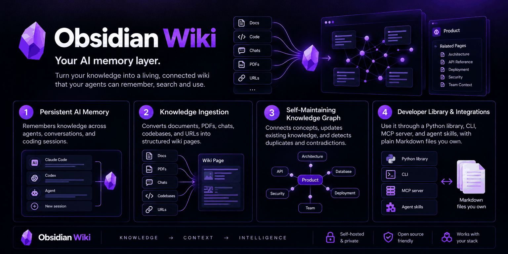
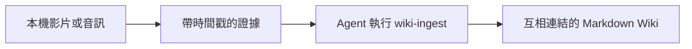

<h1 align="center">obsidian-wiki-video</h1>

<p align="center"><b>讓 AI Agent 把影片、音訊與文件整理成互相連結的 Wiki。</b></p>

<p align="center">
  保留知識、上下文，以及可回聽的原始音訊證據。<br>
  Markdown 優先、由 skill 驅動，延伸自 obsidian-wiki。
</p>

<p align="center">
  <a href="https://github.com/Amiannn/obsidian-wiki-video/pulls"></a>
  <a href="LICENSE"></a>
</p>

<p align="center">
  
</p>

<p align="center">
  
</p>

<p align="center">
  <a href="./README.md">English</a> | 繁體中文
</p>

---

這是 [Ar9av/obsidian-wiki](https://github.com/Ar9av/obsidian-wiki) 的影音擴充版本，沿用相同精神：**由 Agent 將來源整理成互相連結的 Markdown 知識，再持續維護。** 這個 fork 新增帶時間戳的逐字稿、抽樣畫面、可播放音訊片段與聲音量測，作為既有 `wiki-ingest` skill 的來源證據。

Wiki 可以連結「說了什麼」與「如何表達」。說話風格的觀察必須對應原始片段，並區分量測結果與 Agent 的解讀。概念頁、來源頁、交叉連結、來源追蹤與增量更新都沿用原專案流程。

Skill 仍是 Markdown 指令，可由 Claude Code、Cursor、Codex、Windsurf、Gemini CLI 與[其他相容 Agent](./docs/agents.md) 執行。核心 CLI 維持輕量；本機影音處理使用額外安裝的 Python 套件與 FFmpeg。知識整理則由你設定的 Agent 完成。

底層模式來自 Andrej Karpathy 的 [LLM Wiki gist](https://gist.github.com/karpathy/442a6bf555914893e9891c11519de94f)：將知識整理、連結，並隨新證據持續更新。

## 快速開始

**請從這個 fork 安裝，才能使用影音指令。** 從 PyPI 安裝 `obsidian-wiki`，或使用上游只提供 skill 的 plugin，都不會安裝此分支的影音實作。

需要 Python 3.9+，以及系統上的 `ffmpeg`／`ffprobe`。以下範例使用相容 Bash 的 shell；Windows 請改用對應的虛擬環境啟動指令。

```bash
git clone --branch feat/video-ingest https://github.com/Amiannn/obsidian-wiki-video.git
cd obsidian-wiki-video
python -m venv .venv
source .venv/bin/activate
python -m pip install -e '.[media]'
obsidian-wiki setup --vault ~/video-wiki
```

CLI 與套件名稱仍是 `obsidian-wiki`。Setup 會安裝 skill 並註冊 session hook；加上 `--no-hooks` 可略過 hook。接著告訴 Agent **「set up my wiki」**，初始化 Wiki 內容。

如果只處理文字，改用 `python -m pip install -e .` 即可。[安裝說明](./docs/installation.md) 保留上游的其他設定方式；影音功能請使用上面的 fork 安裝流程。

## 從影片建立 Wiki

在同一個已啟動的虛擬環境中，處理本機錄影：

```bash
obsidian-wiki media prepare /path/to/video.mp4 \
  --vault ~/video-wiki --language zh --pitch
```

英文可改用 `--language en`，省略則自動偵測。預設使用 faster-whisper `small`，在本機 CPU 以 `int8` 執行；首次使用會下載模型權重。GPU 選項與外部逐字稿輸入方式見[影音匯入說明](./docs/media.md)。

指令會回傳包含 `source` 路徑的 JSON。將該完整路徑交給 Agent：

```text
/wiki-ingest <source path returned by media prepare>
```

`media prepare` 負責擷取證據；**Wiki 的知識整理仍由 Agent 執行**。來源包已產生或命中快取，不代表內容已匯入 Wiki。



| 證據類型 | 目前提供的能力 |
|---|---|
| 說話內容 | ASR 逐字稿與近似的分段時間戳，或外部提供的逐字稿 JSON |
| 畫面資訊 | 等距抽樣畫面，交由具備視覺能力的 Agent 閱讀 |
| 音訊播放 | 原始影音、抽出的音軌與可播放的代表片段 |
| 表達量測 | RMS 音量、低能量區間、逐字稿每分鐘字元數，以及可選的音高百分位數 |
| 來源追蹤 | 來源雜湊、處理設定、片段引用與可重用的擷取結果 |
| Wiki 整合 | 既有分類、頁面合併、交叉連結、快照、manifest 與記憶更新 |

聲音量測可作為解讀依據：低能量區間不一定是說話停頓，每分鐘字元數也不等於每分鐘單字數。目前不會自動分類情緒、個性或穩定的說話風格；風格觀察需要片段引用與上下文支持。

**目前範圍：** 僅支援本機檔案，尚未加入 YouTube 下載、自動講者分辨、場景偵測或自動 OCR。外部提供的講者標籤只適用於該段錄音。首次試跑使用 11 秒英語語音與明確標示的合成投影片；尚未評測中文辨識品質或複雜影片理解能力。本機試跑的 vault 未收錄在 repository 中。

格式、輸出結構、快取與驗證細節 → **[影音匯入說明](./docs/media.md)**（英文）

## 你實際會做的事

**餵養它。** 文件、PDF、聊天匯出、會議逐字稿、截圖、網址，以及經過上述證據擷取流程的本機影片與音訊。

```text
/wiki-ingest ~/research
/wiki-update                        # 蒸餾你目前所在的這個 repo（支持使用 codegraph 增強程式碼結構解析）
/wiki-capture                       # 把這段對話存下來
/wiki-history-ingest claude         # 挖出你問過 Claude 的所有東西
```

**問它。** 回答會附上 `[[wikilink]]` 引用，而不是憑感覺。

```text
/wiki-query what do I know about rate limiting?
/wiki-narrate MCP security          # 針對一個主題產生有引用的簡報
/wiki-digest week                   # 我這週學到了什麼？
```

**找出那個你叫不出名字的 session。**

```bash
obsidian-wiki sessions-build
obsidian-wiki sessions-query "the auth bug with the weird retry loop"
```

**維持它的品質。** vault 自己會變亂，這些 skill 負責整理。

```text
/wiki-lint            # 壞掉的連結、孤兒頁面、互相矛盾的內容
/wiki-dedup           # 「RSC」和「React Server Components」現在是同一頁了
/cross-linker         # 把新頁面編織進知識圖譜
/wiki-status          # 已匯入什麼、還有什麼待處理、樞紐頁面在哪
```

全部 skill 請見 **[Skills Reference](./docs/skills.md)**（英文）

## 看見它

在 Obsidian 打開 vault，然後開啟 graph view（Cmd/Ctrl+P → 「Open graph view」）。說 **「color my graph」**，它就會依照 tag、category 或 visibility 為節點上色。

想先看看再動手？[`examples/demo-vault/`](./examples/demo-vault) 是一個 18 頁的範例 vault，主題是打造可靠的 LLM agent，已經依資料夾上好顏色。Clone 這個 repo，在 Obsidian 選 *Open folder as vault*，再選那個資料夾即可。

<p align="center">
  
</p>

你也可以把整個圖譜匯出成 `graph.json`、GraphML（Gephi/yEd）、Neo4j Cypher、Postgres SQL，或一個自帶所有資源的互動式 `graph.html`。

## 用 Python 直接使用

```python
from obsidian_wiki import Memory

memory = Memory("~/brain")
memory.remember("stack", "Python, FastAPI", confidence=0.9)
memory.add("選 Postgres 而不是 MySQL，是為了 partial index。")
memory.search("postgres")
memory.recap()                       # 在 session 開始時注入
```

不需要 API key、不需要 embedding 模型、不需要向量資料庫、不需要連網——vault 就是磁碟上的 markdown，所以 agent 記住的每件事你都能讀、能 grep、能 diff。`user_id` 會隔離「關於某個人」的記憶，知識本身則仍然共享。

更多 → **[Python API](./docs/python-api.md)**（英文）

## 它會跨 session 記住

一個 session 開始時，vault 的記憶就已經在 context 裡了——你是誰、有哪些未完成的線索、最近改了什麼——並在結束時，趁 context 關閉前把值得留下的內容擷取起來。

<p align="center">
  
</p>

`index.md`、`log.md`、`hot.md`，以及 `_meta/` 底下的擁有者檔案與待辦索引，全都經由同一個 writer 寫入；它會取得 lock 並以 atomic 方式寫檔，所以平行執行的 agent 不會蓋掉彼此的更新。

更多 → **[Memory Surface](./docs/memory.md)**

## 為什麼不是一個筆記資料夾就好

- **它會編譯，而不是堆積。** 新知識會合併進既有頁面，矛盾會被標記出來，內容不會重複。
- **它只讀有變動的部分。** manifest 追蹤每個匯入過的來源，所以第二次執行只處理差異，而不是重跑整個資料庫。
- **你分得出哪些是知識、哪些是猜測。** 每個陳述都會標記為 `extracted`、`^[inferred]` 或 `^[ambiguous]`，lint 會標出開始偏向臆測的頁面。
- **查詢成本不隨規模爆炸。** 先讀標題、tag 和 summary，需要時才打開頁面內容。20 頁或 2000 頁，成本差不多。
- **它是你的。** 就是資料夾裡的純 markdown。推到私人 repo、用 Obsidian 打開、用 grep 搜、直接刪掉都行。資料儲存在本機，不需要代管 Wiki 服務。知識整理時如何處理輸入內容，取決於你使用的 Agent 服務。
- **它會把脈絡帶到下一個 session。** 擁有者檔案、未完成的線索，以及一份滾動的快照，會在 session 開始時注入，你不用再把自己重新介紹一遍。
- **在你原本工作的地方就能用。** 一個 `.skills/` 目錄，symlink 到你使用的每一個 agent。

更多細節請見 **[Architecture](./docs/architecture.md)**（英文）

## 和其他做法比較

| | obsidian-wiki-video | 桌面版 LLM-wiki 應用 | MCP 記憶伺服器 | 單一 skill 的 LLM wiki |
|---|---|---|---|---|
| **知識存在哪裡** | 你 Obsidian vault 裡的 Markdown | 由應用程式管理的資料夾 | 資料庫或事件紀錄 | 一個 Markdown 資料夾 |
| **能搭配哪些工具** | Claude Code、Codex、Cursor、Gemini CLI，以及另外十多種 | 只有該應用程式本身 | 任何 MCP 用戶端 | 通常只有一種 agent |
| **你要安裝什麼** | Markdown skill；影音匯入另需 Python CLI、選用套件與 FFmpeg | 桌面應用程式加上 LLM API key | 一個伺服器程序 | 一個 skill |
| **能挖掘過去的 agent session** | Claude、Codex、Copilot、Hermes、OpenClaw、Pi | 不行 | 只能擷取新的 session | 不行 |
| **會自我整理** | Lint、去重、交叉連結、標籤分類 | 視產品而定 | 不適用 | 頂多有 lint |

## 真的有幫助嗎？

以下圖譜查詢結果來自上游專案，不是此 fork 的影音效能測試；影音試跑的範圍請見[原型驗證](./docs/media.md#prototype-validation)。

結構性問題——「X 和 Y 是怎麼連起來的」、「哪些頁面撐住了整個 vault」、「刪掉這頁會壞掉什麼」——正是一般 agent 最不擅長的。它每一次都得 grep 過所有檔案，再自己把連結圖重建一遍。

同一個模型、同一個 vault、同樣的問題，唯一的差別是有沒有裝 `obsidian-wiki`：

| | 一般 agent | 裝了 obsidian-wiki |
|---|---|---|
| **回答耗時** | 81 秒 | **19 秒** — 快 4.4 倍 |
| **答對比例** | 44% | **83%** |
| **使用的工具呼叫次數** | 9.9 | **4.6** |
| **API 成本** | $0.202 | $0.208 — 沒有變化 |

| 問題 | 一般 agent | 裝了 obsidian-wiki |
|---|---|---|
| 「X 和 Y 是怎麼連起來的？」 | 122 秒 | 18 秒 |
| 「我有哪些主題叢集？」 | 117 秒 | 21 秒 |
| 「哪些頁面撐住了整個 vault？」 | 61 秒 | 12 秒 |
| 「刪掉 X 會壞掉什麼？」 | 26 秒 | 24 秒 |

正確率的差距不是誤差。被要求追出一條連結路徑時，一般 agent 會繞過 `index.md`——那頁連到*每一個*頁面，所以它「找到」了一條毫無意義的短路徑。兩次執行都犯了同樣的錯，而且還把 `index` 說成 vault 裡最重要的頁面之一。這些 skill 查詢的圖已經排除了記帳用的檔案，所以那種答案根本不會出現。

<details>
<summary>方法，以及這個測試無法證明的事</summary>

使用 Claude Sonnet，以 headless 模式在一個真實的 38 頁 vault 上執行。問題都用一般口語提出，沒有另外說明圖的定義——一般 agent 有 `Read`/`Grep`/`Glob`/`Bash`，得自己想辦法（它做得不錯，甚至自己寫了一份中心性演算法，而不是隨便猜）。4 個問題 × 2 種條件 × 2 次重複，序列執行，避免互搶 CPU。

基準答案來自 **networkx**，而不是本專案自己的程式碼：betweenness 在每個節點上的誤差都在 3.5e-18 以內，630 組最短路徑也全部一致。

這是個小規模測試——每格 n=2，只用了一個 38 頁的 vault——所以確切的百分比僅供參考。時間差距（3～6 倍）遠大於各次執行之間的波動；正確率的數字則建立在較少的樣本上。「裝了」那一欄有一次執行完全失敗：模型沒有使用 CLI，自己 grep，然後答錯了。

完整資料、每次執行的紀錄與規模測試結果都在 [PR #175](https://github.com/Ar9av/obsidian-wiki/pull/175)。

</details>

## 文件

以下文件目前為英文版本。

| | |
|---|---|
| **[影音匯入說明](./docs/media.md)** | 影音安裝、量測、證據來源包、限制與驗證 |
| **[Installation](./docs/installation.md)** | pip、clone、由 agent 設定、多個 vault |
| **[Skills Reference](./docs/skills.md)** | 全部 skill 與其 slash command |
| **[Agent Compatibility](./docs/agents.md)** | 完整相容性表格與各 agent 手動設定 |
| **[CLI Reference](./docs/cli.md)** | 每一個 `obsidian-wiki` 子命令 |
| **[Configuration](./docs/configuration.md)** | 設定變數、QMD 語意搜尋、`_raw/` 暫存區、GitHub 同步 |
| **[Architecture](./docs/architecture.md)** | 四個匯入階段、vault 結構、我們在 Karpathy 模式上加了什麼 |
| **[Python API](./docs/python-api.md)** | `from obsidian_wiki import Memory`——把 vault 當成 agent 記憶使用 |
| **[Memory Surface](./docs/memory.md)** | index、log、hot cache、擁有者檔案與待辦索引 |
| **[Session Brain](./docs/session-brain.md)** | 建立在 agent session 歷史之上的主題圖譜 |
| **[Browser Extension](./docs/browser-extension.md)** | 將網頁擷取進 vault，並用 vault 內容填寫網頁表單 |
| **[Deployment](./docs/deployment.md)** | 以 Docker 將 vault 部署成記憶服務，讓 agent 透過 HTTP/MCP 存取 |
| **[Contributing](./docs/contributing.md)** | 新增 skill、維持兩份 README 同步 |

## 參與貢獻

這個專案還很早期。skills 是能用的，但還有很多空間讓這個大腦變得更聰明：更好的交叉引用、更精準的去重、支撐更大的 vault、更多匯入來源。如果你有一個工作流程適合做成 skill，[歡迎送 PR](./docs/contributing.md)。

會說其他語言嗎？翻譯這份 README 很適合當作第一個 PR，而且完全不用寫程式：請見 [Adding a README translation](./docs/contributing.md#adding-a-readme-translation)（英文）。

## 授權

[MIT](./LICENSE)
